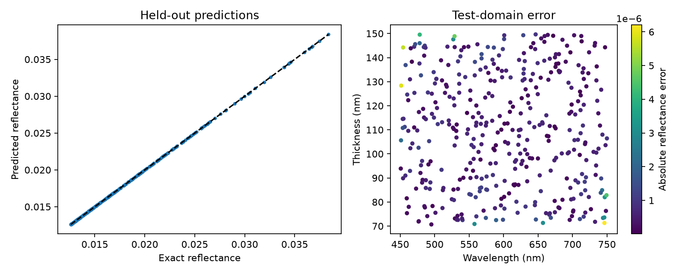

# Thin-film reflectance surrogate — OptiIA Consulting

Train a polynomial ridge-regression surrogate for normal-incidence single-layer reflectance and compare it with the analytical model.

Reproducible project example using synthetic data. No proprietary code or datasets are included.



## Run

Python 3.12 recommended. From this repository:
```bash
python -m pip install -r requirements.txt
python -m unittest -v test_analysis
python analysis.py --seed 42 --out results
```

The script regenerates the data, plots and metrics in `results/`. The root `preview.png` and `metrics.json` show the seed-42 example. Change `--seed` to inspect another realization. Import the functions in `analysis.py` for your own arrays; review their units and input requirements first.

## Method

Generate independent training and test wavelength/thickness pairs. Compute the exact coherent single-layer Fresnel reflectance (air, film index 1.38, substrate index 1.52). Fit standardized degree-8 polynomial features with ridge regularization using training data only. Evaluate on 400 held-out samples against a training-mean baseline and report out-of-range predictions. Export predictions and a visual error map.

## Assumptions and limits

Lossless, nondispersive single layer at normal incidence, wavelengths 450–750 nm and thicknesses 70–150 nm. The model is a small supervised regression example, not a neural network or validated inverse-design system. No extrapolation or speed advantage is claimed; the exact formula is already inexpensive. Multilayers, absorption, dispersion and oblique incidence are excluded.

Metrics describe this synthetic example only. Real measurements require representative data, calibrated inputs and independent validation.

## Validation

Four automated tests check analytical/noiseless references, independent inputs or noise realizations, and invalid inputs. See `test_analysis.py`.

## Applications

Scientific data analysis, numerical optics and Python automation for research workflows. This example is independent of the other projects in the [portfolio](https://github.com/yaghi-ali).

OptiIA Consulting · contact@optiia-consulting.fr · https://www.optiia-consulting.fr
